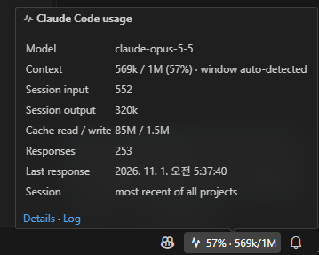
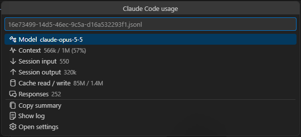
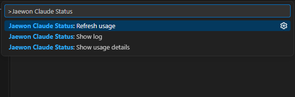
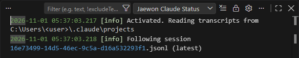
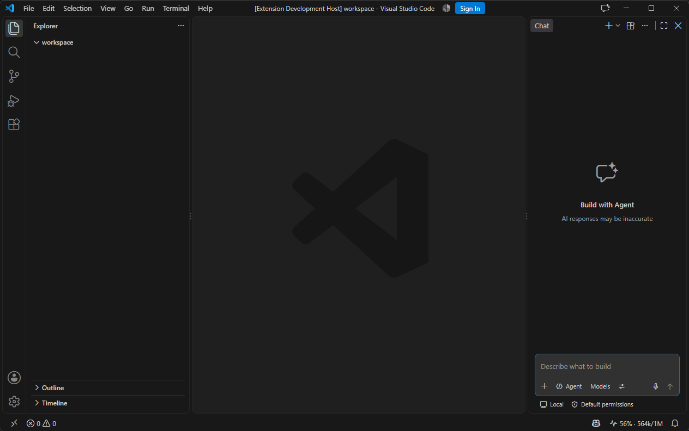

<p align="center"></p>

# jaewon-claude-status

[English](README.md) · [한국어](README.ko.md) · **日本語** · [简体中文](README.zh-CN.md)

Claude Code のコンテキストウィンドウの使用率と、セッションで使ったトークン数を VS Code のステータスバーで確認できます。

> コミュニティ製の非公式拡張機能です。Anthropic とは無関係で、Anthropic による承認やサポートはありません。「Claude」「Claude Code」は Anthropic の商標です。


## 機能

| | |
|---|---|
| **コンテキストをひと目で** | 現在の Claude Code セッションのコンテキスト使用量を `56% · 564k/1M` のように表示します。 |
| **色による警告** | 70% で黄色、90% で赤になります（変更可能）。`/compact` のタイミングがわかります。 |
| **セッション合計** | ホバーすると、モデル、コンテキスト、入力・出力トークン、キャッシュ読み取り・書き込み、応答数、最後の応答時刻を表示します。 |
| **詳細表示・コピー** | 項目をクリックすると詳細一覧が開き、概要をテキストでコピーできます。 |
| **費用の推定（任意）** | 100 万トークンあたりの単価を入力すると推定費用を表示します。入力しない限り表示しません。 |
| **ログ** | セッションの切り替え、更新、読み取れなかった行を *Jaewon Claude Status* 出力チャネルに記録します。 |
| **4 言語** | 英語・韓国語・日本語・簡体字中国語の UI。VS Code の表示言語に従います。 |
| **プライバシー** | ローカルファイルのみを読み取ります。ネットワーク通信、テレメトリ、アカウントへのアクセスはありません。 |

## スクリーンショット

**ツールチップ** – モデル、検出したウィンドウサイズ付きのコンテキスト、セッションのトークン合計、キャッシュ使用量、応答数、追跡中のセッション。



**詳細（項目をクリック）** – 同じ数値を一覧で表示し、*概要をコピー*、*ログを表示*、*設定を開く* を提供します。



**コマンド** – コマンドパレットで `Jaewon Claude Status` と入力します。



**ログ** – 表示 › 出力 › *Jaewon Claude Status*



**ウィンドウ全体** – 項目はステータスバーの右側にあります。



## 仕組み

Claude Code はすべての会話を `~/.claude/projects/<プロジェクト>/<セッション>.jsonl`（または `CLAUDE_CONFIG_DIR` 配下）に記録し、応答ごとに使用トークンを残します。拡張機能は次のように動作します。

1. 開いているフォルダーの最新の会話記録を探します（`sessionScope` で全プロジェクトの最新にもできます）。
2. 5 秒ごとに、前回以降に追加された部分だけを読みます。
3. **コンテキスト** = 最新のメイン応答の入力 + キャッシュ読み取り + キャッシュ書き込みトークン。サブエージェントの応答は合計に加えますが、コンテキストの値は置き換えません。
4. Claude Code が 1 つの応答を複数行に分けて記録しても 1 回だけ数えます。

**コンテキストウィンドウ**は既定で 200k です。モデル ID に `[1m]` が含まれるか、コンテキストがすでに 200k を超えている場合は 1M とみなします。`contextWindow` に数値を設定するとその値を使います。

## コマンド

| コマンド | 内容 |
|---|---|
| `Jaewon Claude Status: 使用量の詳細を表示` | 詳細一覧を開きます（項目のクリックと同じ）。 |
| `Jaewon Claude Status: 使用量を更新` | 会話記録を最初から読み直します。 |
| `Jaewon Claude Status: ログを表示` | 出力チャネルを開きます。 |

## 設定

| 設定 | 既定値 | 説明 |
|---|---|---|
| `jaewonClaudeStatus.enabled` | `true` | ステータスバー項目を表示 |
| `jaewonClaudeStatus.sessionScope` | `workspace` | `workspace`: 開いているフォルダーの最新セッション（なければ全体の最新）。`latest`: 全プロジェクトの最新セッション |
| `jaewonClaudeStatus.statusFormat` | `$(pulse) {percent}% · {context}/{window}` | プレースホルダー `{percent}` `{context}` `{window}` `{model}` `{session}` `{output}` `{cost}`。Codicon 使用可 |
| `jaewonClaudeStatus.contextWindow` | `auto` | ウィンドウサイズ（トークン）または `auto` |
| `jaewonClaudeStatus.warningThreshold` | `70` | 黄色背景の基準 (%) |
| `jaewonClaudeStatus.errorThreshold` | `90` | 赤背景の基準 (%) |
| `jaewonClaudeStatus.refreshIntervalSeconds` | `5` | 会話記録を確認する間隔（秒） |
| `jaewonClaudeStatus.alignment` | `right` | ステータスバーの位置 |
| `jaewonClaudeStatus.pricing` | `{}` | モデル ID 接頭辞ごとの 100 万トークンあたりの USD 単価（任意） |

費用推定の例（数値はプレースホルダーです。実際の単価を入力してください）:

```json
"jaewonClaudeStatus.pricing": {
  "claude-opus": { "input": 0, "output": 0, "cacheRead": 0, "cacheWrite": 0 }
},
"jaewonClaudeStatus.statusFormat": "$(pulse) {percent}% · {context}/{window} · {cost}"
```

## 制限事項

- **プランの上限（5 時間・週間）は表示しません。** Claude Code が会話記録に書き込まないためです。Claude Code の `/usage` で確認してください。
- 費用は入力した単価による推定値で、実際の請求額ではありません。
- Claude Code がディスクに書き込んだ内容のみを表示するため、応答ごとに更新されます。

## プライバシー

この拡張機能は自分の PC にある会話記録を読み、トークン数だけをメモリに保持します。どこにも送信・保存しません。

## 要件

VS Code 1.90 以降、同じ PC 上の Claude Code（CLI または VS Code 拡張機能）

## ライセンス

[MIT](LICENSE)
