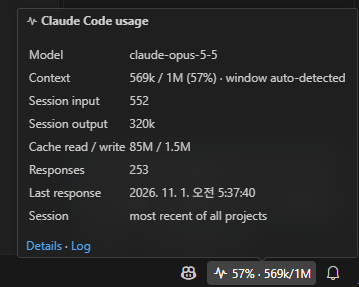
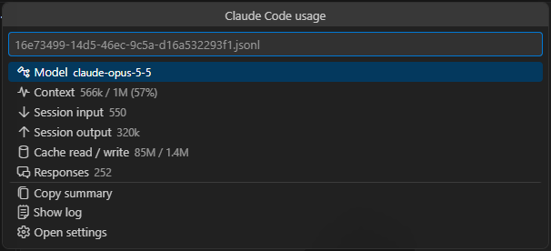
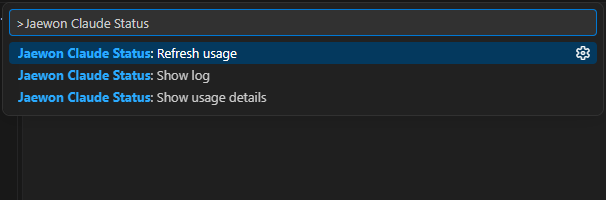
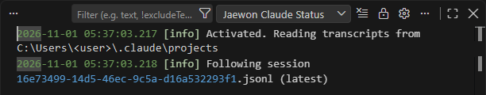
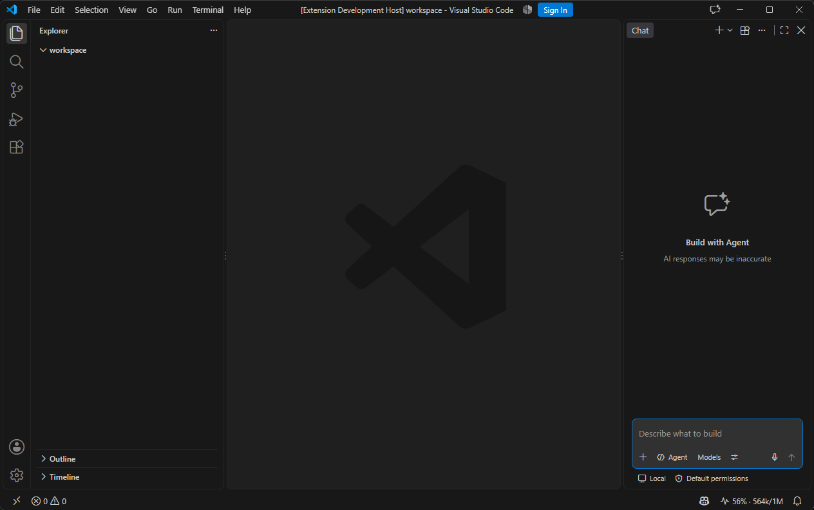

<p align="center"></p>

# jaewon-claude-status

[English](README.md) · **한국어** · [日本語](README.ja.md) · [简体中文](README.zh-CN.md)

Claude Code의 컨텍스트 창이 얼마나 찼는지, 세션에서 토큰을 얼마나 썼는지 VS Code 하단 상태 표시줄에서 바로 확인할 수 있습니다.

> 커뮤니티에서 만든 비공식 확장입니다. Anthropic과 관련이 없고, Anthropic이 보증하거나 지원하지 않습니다. "Claude"와 "Claude Code"는 Anthropic의 상표입니다.


## 기능

| | |
|---|---|
| **컨텍스트 한눈에 보기** | 상태 표시줄에 현재 Claude Code 세션의 컨텍스트 사용량을 `56% · 564k/1M`처럼 표시합니다. |
| **색상 경고** | 70%에서 노란색, 90%에서 빨간색으로 바뀝니다(설정 가능). `/compact`할 때를 알 수 있습니다. |
| **세션 합계** | 마우스를 올리면 모델, 컨텍스트, 입력·출력 토큰, 캐시 읽기·쓰기, 응답 수, 마지막 응답 시각을 보여 줍니다. |
| **자세히 보기·복사** | 항목을 누르면 상세 목록이 열리고, 요약을 텍스트로 바로 복사할 수 있습니다. |
| **비용 추정(선택)** | 100만 토큰당 단가를 직접 입력하면 추정 비용을 보여 줍니다. 입력하지 않으면 표시하지 않습니다. |
| **로그** | 세션 전환, 새로고침, 읽지 못한 줄을 *Jaewon Claude Status* 출력 채널에 기록합니다. |
| **4개 국어** | 영어·한국어·일본어·중국어(간체) UI. VS Code 표시 언어를 따릅니다. |
| **개인정보 보호** | 로컬 파일만 읽습니다. 네트워크 통신, 원격 측정, 계정 접근이 없습니다. |

## 화면

**툴팁** – 모델, 감지한 창 크기와 함께 컨텍스트, 세션 토큰 합계, 캐시 사용량, 응답 수, 따라가는 세션을 보여 줍니다.



**자세히 보기(항목 클릭)** – 같은 수치를 목록으로 보여 주고 *요약 복사*, *로그 보기*, *설정 열기*를 제공합니다.



**명령** – 명령 팔레트에서 `Jaewon Claude Status`를 입력합니다.



**로그** – 보기 › 출력 › *Jaewon Claude Status*



**전체 화면** – 항목은 상태 표시줄 오른쪽에 있습니다.



## 동작 방식

Claude Code는 모든 대화를 `~/.claude/projects/<프로젝트>/<세션>.jsonl`(또는 `CLAUDE_CONFIG_DIR` 아래)에 기록하고, 응답마다 사용한 토큰을 남깁니다. 확장은 다음 순서로 동작합니다.

1. 열려 있는 폴더의 가장 최근 대화 기록을 찾습니다. `sessionScope` 설정에 따라 전체 프로젝트 중 가장 최근 기록을 쓸 수도 있습니다.
2. 5초마다 지난번 이후 새로 추가된 부분만 읽습니다.
3. **컨텍스트**는 가장 최근 메인 응답의 입력 + 캐시 읽기 + 캐시 쓰기 토큰입니다. 서브에이전트 응답은 합계에는 더하지만 컨텍스트 값을 바꾸지 않습니다.
4. Claude Code가 한 응답을 여러 줄로 나눠 기록해도 한 번만 셉니다.

**컨텍스트 창 크기**는 기본 200k입니다. 모델 ID에 `[1m]`가 있거나 컨텍스트가 이미 200k를 넘으면 1M으로 봅니다. `contextWindow`에 숫자를 넣으면 그 값을 씁니다.

## 명령

| 명령 | 기능 |
|---|---|
| `Jaewon Claude Status: 사용량 자세히 보기` | 상세 목록을 엽니다(항목 클릭과 같음). |
| `Jaewon Claude Status: 사용량 새로고침` | 대화 기록을 처음부터 다시 읽습니다. |
| `Jaewon Claude Status: 로그 보기` | 출력 채널을 엽니다. |

## 설정

| 설정 | 기본값 | 설명 |
|---|---|---|
| `jaewonClaudeStatus.enabled` | `true` | 상태 표시줄 항목 표시 |
| `jaewonClaudeStatus.sessionScope` | `workspace` | `workspace`: 열린 폴더의 최근 세션(없으면 전체 최근). `latest`: 모든 프로젝트의 최근 세션 |
| `jaewonClaudeStatus.statusFormat` | `$(pulse) {percent}% · {context}/{window}` | 자리표시자 `{percent}` `{context}` `{window}` `{model}` `{session}` `{output}` `{cost}`. Codicon 사용 가능 |
| `jaewonClaudeStatus.contextWindow` | `auto` | 창 크기(토큰) 또는 `auto` |
| `jaewonClaudeStatus.warningThreshold` | `70` | 노란색 배경 기준(%) |
| `jaewonClaudeStatus.errorThreshold` | `90` | 빨간색 배경 기준(%) |
| `jaewonClaudeStatus.refreshIntervalSeconds` | `5` | 대화 기록 확인 주기(초) |
| `jaewonClaudeStatus.alignment` | `right` | 상태 표시줄 위치 |
| `jaewonClaudeStatus.pricing` | `{}` | 모델 ID 접두사별 100만 토큰당 USD 단가(선택) |

비용 추정 예시입니다. 아래 숫자는 자리표시자이니, 실제 적용되는 단가를 넣으세요.

```json
"jaewonClaudeStatus.pricing": {
  "claude-opus": { "input": 0, "output": 0, "cacheRead": 0, "cacheWrite": 0 }
},
"jaewonClaudeStatus.statusFormat": "$(pulse) {percent}% · {context}/{window} · {cost}"
```

## 제한 사항

- **요금제 한도(5시간·주간)는 표시하지 않습니다.** Claude Code가 대화 기록에 남기지 않기 때문입니다. Claude Code에서 `/usage`로 확인하세요.
- 비용은 입력한 단가로 계산한 추정값이며 실제 청구액이 아닙니다.
- Claude Code가 디스크에 기록한 내용만 보여 주므로, 응답이 끝날 때마다 갱신됩니다.

## 개인정보

이 확장은 내 PC의 대화 기록 파일을 읽어 토큰 수만 메모리에 보관합니다. 어디로도 전송하거나 저장하지 않습니다.

## 요구 사항

VS Code 1.90 이상, 같은 PC에 Claude Code(CLI 또는 VS Code 확장)

## 라이선스

[MIT](LICENSE)
