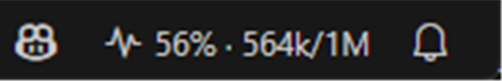
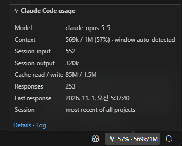
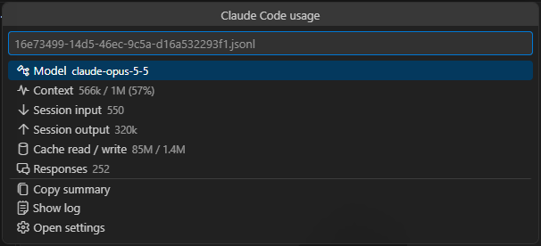
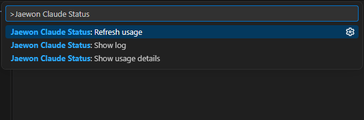
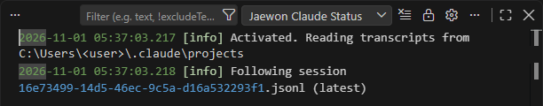
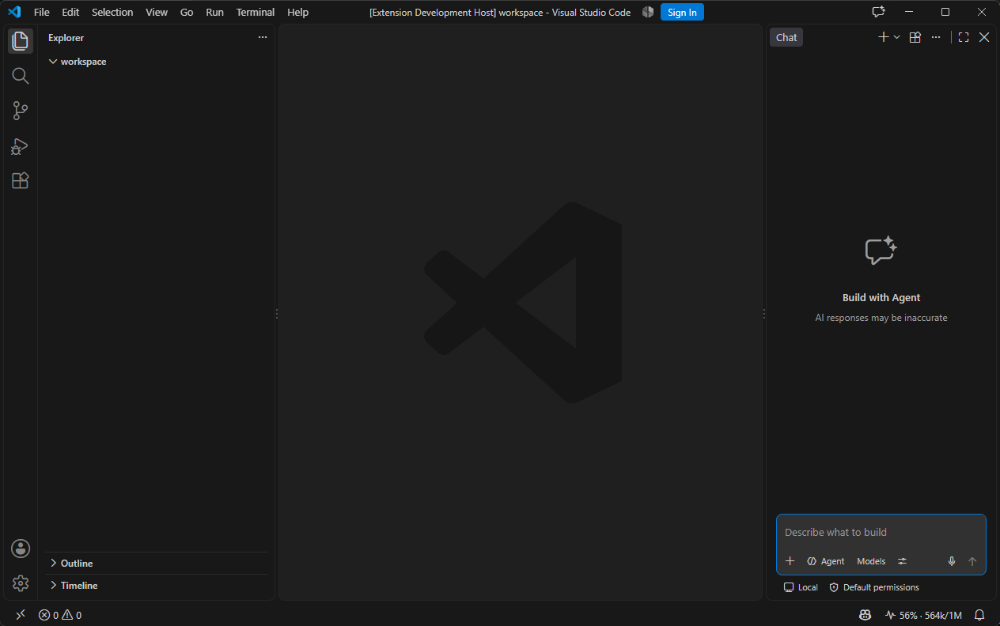

<p align="center"></p>

# jaewon-claude-status

**English** · [한국어](README.ko.md) · [日本語](README.ja.md) · [简体中文](README.zh-CN.md)

See how full your Claude Code context window is, and how many tokens the session has used, right in the VS Code status bar.

> Unofficial community extension. Not affiliated with, endorsed by, or supported by Anthropic. "Claude" and "Claude Code" are trademarks of Anthropic.



## Features

| | |
|---|---|
| **Context at a glance** | The status bar shows the live context fill of your Claude Code session: `56% · 564k/1M`. |
| **Colour warnings** | The item turns yellow at 70% and red at 90% (both configurable), so you know when to `/compact`. |
| **Session totals** | Hover for model, context, input/output tokens, cache read/write, number of responses and time of the last response. |
| **Details & copy** | Click the item for a details list; copy a plain-text summary in one step. |
| **Optional cost estimate** | Enter your own per-million-token prices and see an estimated cost. Nothing is shown until you do. |
| **Log** | Every session switch, refresh and unreadable line is written to the *Jaewon Claude Status* output channel. |
| **4 languages** | UI in English, Korean, Japanese and Simplified Chinese (follows your VS Code display language). |
| **Private by design** | Reads local files only. No network calls, no telemetry, no account access. |

## Screenshots

**Hover tooltip** – model, context with the detected window, session token totals, cache usage, response count and the session being followed.



**Details (click the item)** – the same figures as a list, plus *Copy summary*, *Show log* and *Open settings*.



**Commands** – open the Command Palette and type `Jaewon Claude Status`.



**Log** – View › Output › *Jaewon Claude Status*.



**Full window** – the item sits on the right side of the status bar.



## How it works

Claude Code writes every conversation to a transcript file: `~/.claude/projects/<project>/<session>.jsonl` (or under `CLAUDE_CONFIG_DIR`). Each response in it records the tokens it used. The extension:

1. finds the newest transcript of the folder you have open (or the newest of all projects, see `sessionScope`);
2. reads only the bytes appended since the last check, every 5 seconds;
3. takes **context** = input + cache-read + cache-write tokens of the latest main-thread response (sub-agent responses are counted in the totals but never replace the context figure);
4. counts each response once, even though Claude Code streams it into several lines.

The **context window** is 200k tokens, or 1M when the model id says so (`[1m]`) or the context already exceeds 200k. Set `contextWindow` to a number to override it.

## Commands

| Command | What it does |
|---|---|
| `Jaewon Claude Status: Show usage details` | Opens the details list (same as clicking the item). |
| `Jaewon Claude Status: Refresh usage` | Re-reads the transcript from the beginning. |
| `Jaewon Claude Status: Show log` | Opens the output channel. |

## Settings

| Setting | Default | Description |
|---|---|---|
| `jaewonClaudeStatus.enabled` | `true` | Show the status bar item. |
| `jaewonClaudeStatus.sessionScope` | `workspace` | `workspace`: newest session of an open folder (falls back to newest overall). `latest`: newest session of any project. |
| `jaewonClaudeStatus.statusFormat` | `$(pulse) {percent}% · {context}/{window}` | Placeholders `{percent}` `{context}` `{window}` `{model}` `{session}` `{output}` `{cost}`; codicons allowed. |
| `jaewonClaudeStatus.contextWindow` | `auto` | Window size in tokens, or `auto`. |
| `jaewonClaudeStatus.warningThreshold` | `70` | Percentage for the yellow background. |
| `jaewonClaudeStatus.errorThreshold` | `90` | Percentage for the red background. |
| `jaewonClaudeStatus.refreshIntervalSeconds` | `5` | How often to check the transcript. |
| `jaewonClaudeStatus.alignment` | `right` | Status bar side. |
| `jaewonClaudeStatus.pricing` | `{}` | Optional USD prices per million tokens by model-id prefix. |

Example cost estimate (enter the prices that apply to you; the numbers below are placeholders):

```json
"jaewonClaudeStatus.pricing": {
  "claude-opus": { "input": 0, "output": 0, "cacheRead": 0, "cacheWrite": 0 }
},
"jaewonClaudeStatus.statusFormat": "$(pulse) {percent}% · {context}/{window} · {cost}"
```

## Limits

- **Plan limits (5-hour / weekly) are not shown.** Claude Code does not write them to transcripts; use `/usage` in Claude Code.
- Costs are estimates from your own prices, not your bill.
- Only what Claude Code has written to disk is shown; the item updates after each response.

## Privacy

The extension reads transcript files on your own machine and keeps only token counts in memory. It sends nothing anywhere and stores nothing.

## Requirements

VS Code 1.90 or later and Claude Code (CLI or the VS Code extension) on the same machine.

## License

[MIT](LICENSE)
