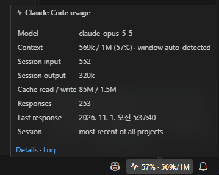
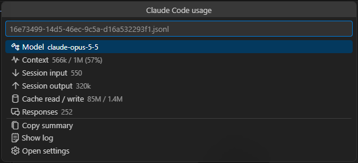
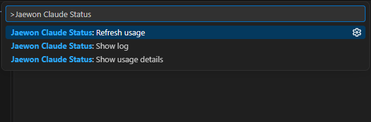
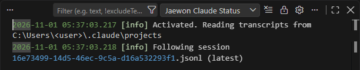
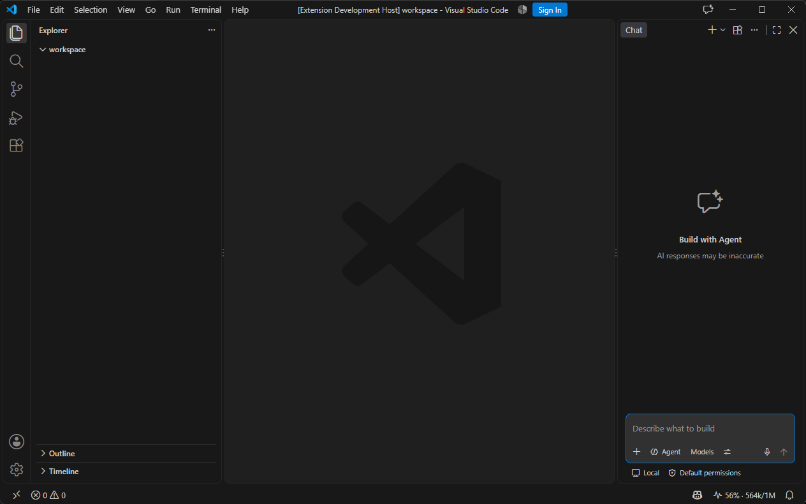

<p align="center"></p>

# jaewon-claude-status

[English](README.md) · [한국어](README.ko.md) · [日本語](README.ja.md) · **简体中文**

在 VS Code 状态栏中直接查看 Claude Code 上下文窗口的使用率，以及当前会话已使用的 token 数。

> 这是社区制作的非官方扩展，与 Anthropic 无关，未获 Anthropic 认可或支持。“Claude” 和 “Claude Code” 是 Anthropic 的商标。


## 功能

| | |
|---|---|
| **上下文一目了然** | 在状态栏中以 `56% · 564k/1M` 的形式显示当前 Claude Code 会话的上下文用量。 |
| **颜色提醒** | 达到 70% 变黄、90% 变红（可配置），提示何时执行 `/compact`。 |
| **会话合计** | 悬停可查看模型、上下文、输入/输出 token、缓存读取/写入、响应数和最近响应时间。 |
| **详情与复制** | 点击状态项打开详情列表，可一键复制文本摘要。 |
| **费用估算（可选）** | 填写每百万 token 的单价后显示估算费用；未填写时不显示。 |
| **日志** | 会话切换、刷新和无法读取的行都会记录到 *Jaewon Claude Status* 输出通道。 |
| **4 种语言** | 英语、韩语、日语、简体中文界面，跟随 VS Code 显示语言。 |
| **隐私优先** | 只读取本地文件。没有网络请求、遥测或账户访问。 |

## 截图

**悬停提示** – 模型、带检测到的窗口大小的上下文、会话 token 合计、缓存用量、响应数以及正在跟踪的会话。



**详情（点击状态项）** – 以列表显示相同数据，并提供*复制摘要*、*显示日志*、*打开设置*。



**命令** – 在命令面板中输入 `Jaewon Claude Status`。



**日志** – 查看 › 输出 › *Jaewon Claude Status*



**完整窗口** – 状态项位于状态栏右侧。



## 工作原理

Claude Code 会把每段对话记录到 `~/.claude/projects/<项目>/<会话>.jsonl`（或 `CLAUDE_CONFIG_DIR` 下），并为每个响应记录所用 token。扩展的工作方式：

1. 查找当前打开文件夹中最新的对话记录（也可通过 `sessionScope` 使用所有项目中最新的）；
2. 每 5 秒只读取自上次检查以来新增的内容；
3. **上下文** = 最新主线程响应的输入 + 缓存读取 + 缓存写入 token。子代理的响应计入合计，但不会替换上下文数值；
4. 即使 Claude Code 将一个响应分成多行记录，也只计算一次。

**上下文窗口**默认为 200k。当模型 ID 含 `[1m]` 或上下文已超过 200k 时视为 1M。将 `contextWindow` 设为数字即可指定。

## 命令

| 命令 | 作用 |
|---|---|
| `Jaewon Claude Status: 显示用量详情` | 打开详情列表（与点击状态项相同）。 |
| `Jaewon Claude Status: 刷新用量` | 从头重新读取对话记录。 |
| `Jaewon Claude Status: 显示日志` | 打开输出通道。 |

## 设置

| 设置 | 默认值 | 说明 |
|---|---|---|
| `jaewonClaudeStatus.enabled` | `true` | 显示状态栏项 |
| `jaewonClaudeStatus.sessionScope` | `workspace` | `workspace`：已打开文件夹的最新会话（没有时使用全部最新）。`latest`：所有项目中最新的会话 |
| `jaewonClaudeStatus.statusFormat` | `$(pulse) {percent}% · {context}/{window}` | 占位符 `{percent}` `{context}` `{window}` `{model}` `{session}` `{output}` `{cost}`，可使用 Codicon |
| `jaewonClaudeStatus.contextWindow` | `auto` | 窗口大小（token）或 `auto` |
| `jaewonClaudeStatus.warningThreshold` | `70` | 黄色背景阈值（%） |
| `jaewonClaudeStatus.errorThreshold` | `90` | 红色背景阈值（%） |
| `jaewonClaudeStatus.refreshIntervalSeconds` | `5` | 检查对话记录的间隔（秒） |
| `jaewonClaudeStatus.alignment` | `right` | 状态栏位置 |
| `jaewonClaudeStatus.pricing` | `{}` | 按模型 ID 前缀设置的每百万 token 美元单价（可选） |

费用估算示例（以下数字为占位符，请填写实际适用的单价）：

```json
"jaewonClaudeStatus.pricing": {
  "claude-opus": { "input": 0, "output": 0, "cacheRead": 0, "cacheWrite": 0 }
},
"jaewonClaudeStatus.statusFormat": "$(pulse) {percent}% · {context}/{window} · {cost}"
```

## 限制

- **不显示套餐限额（5 小时 / 每周）。** Claude Code 不会将其写入对话记录，请在 Claude Code 中使用 `/usage` 查看。
- 费用是根据您填写的单价计算的估算值，并非实际账单。
- 仅显示 Claude Code 已写入磁盘的内容，因此每次响应结束后更新。

## 隐私

本扩展读取您本机上的对话记录文件，只在内存中保存 token 数量，不发送也不存储任何内容。

## 要求

VS Code 1.90 或更高版本，同一台电脑上安装 Claude Code（CLI 或 VS Code 扩展）。

## 许可证

[MIT](LICENSE)
